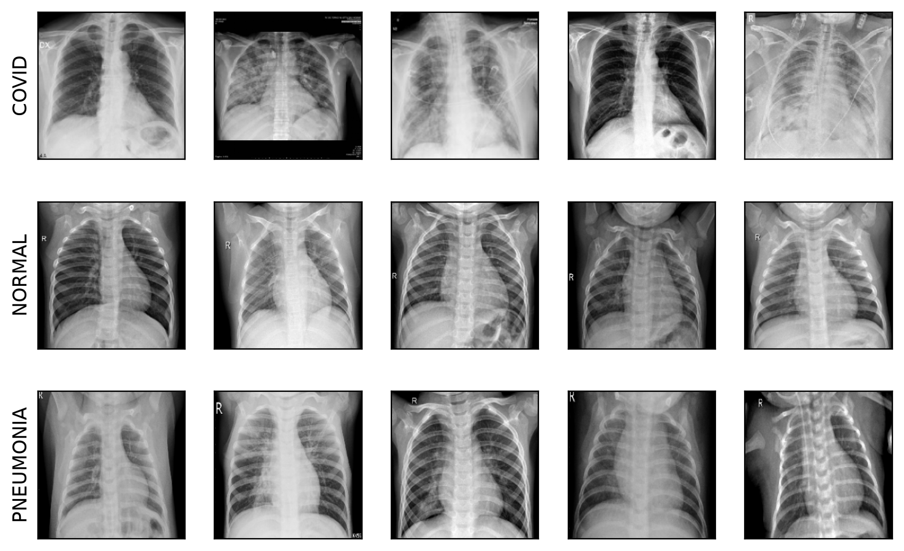
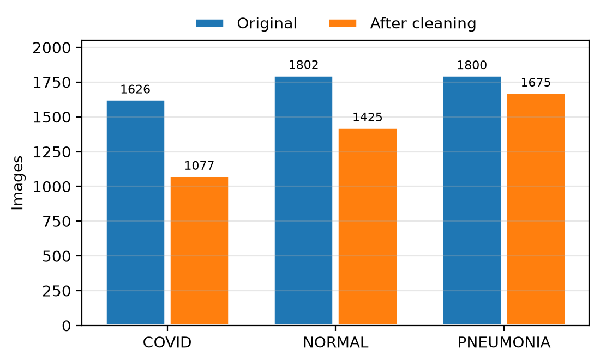
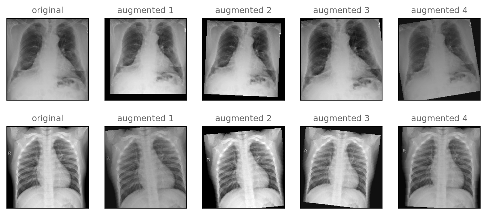
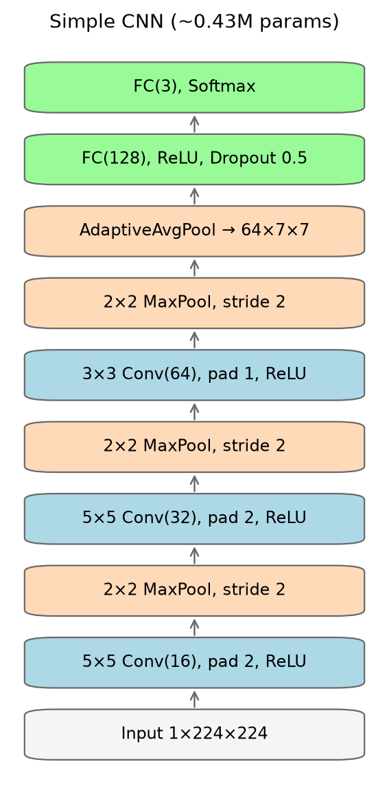
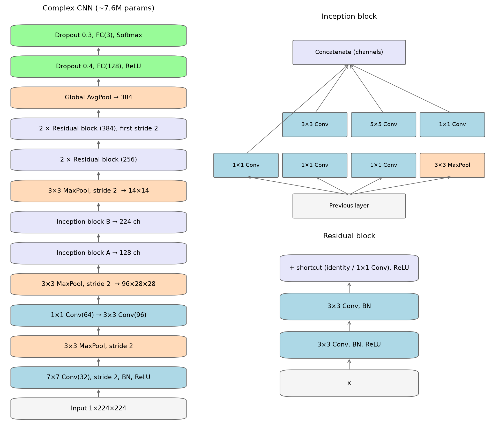
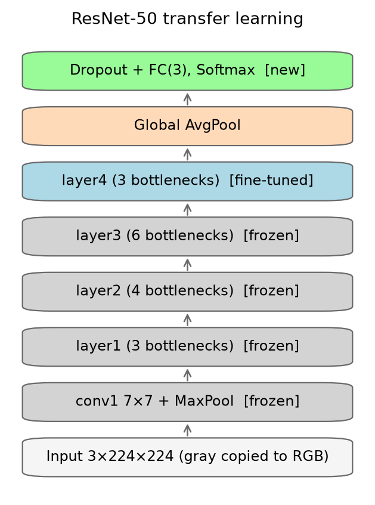
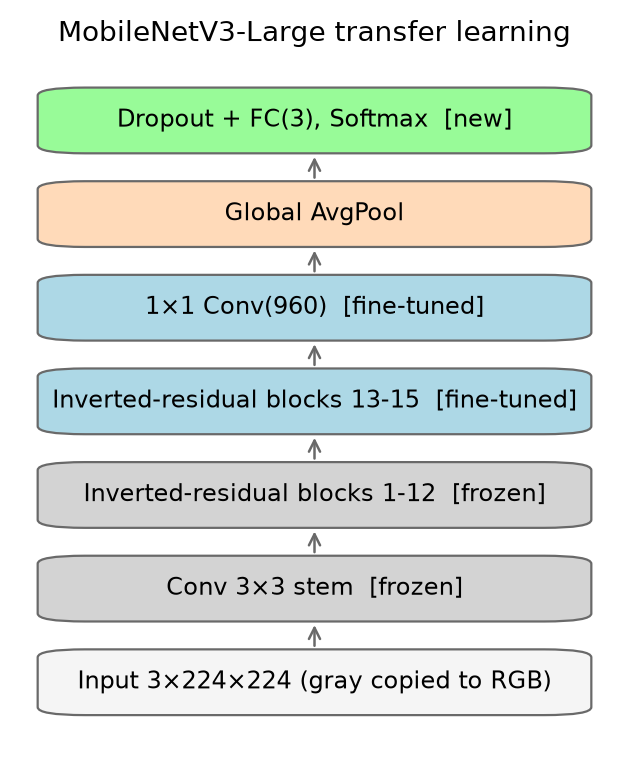
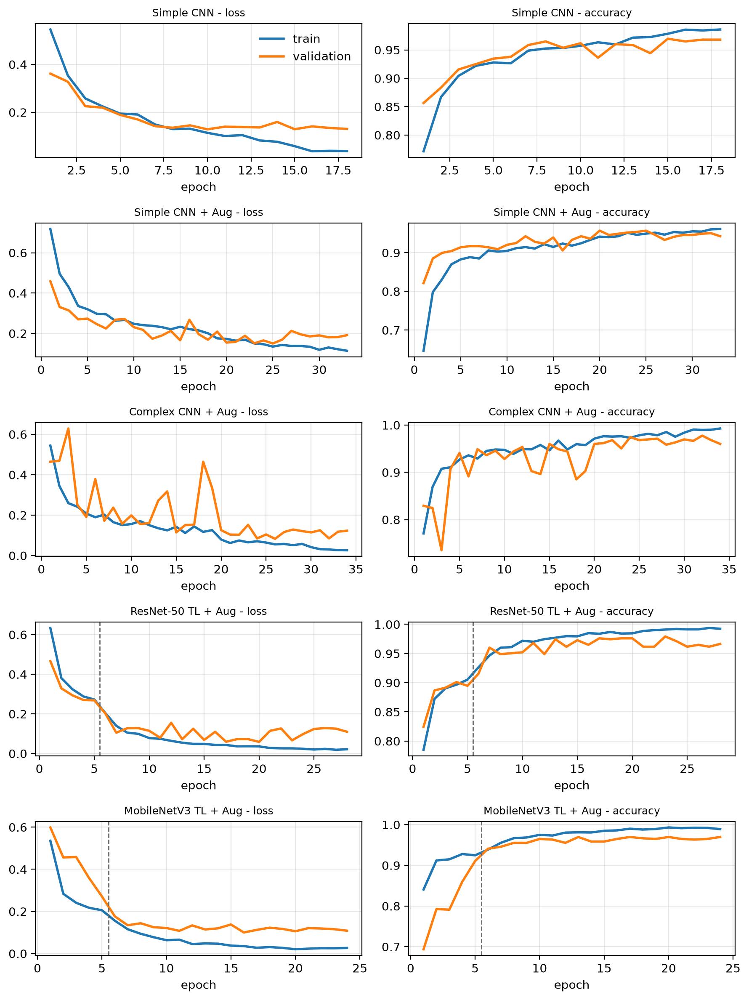
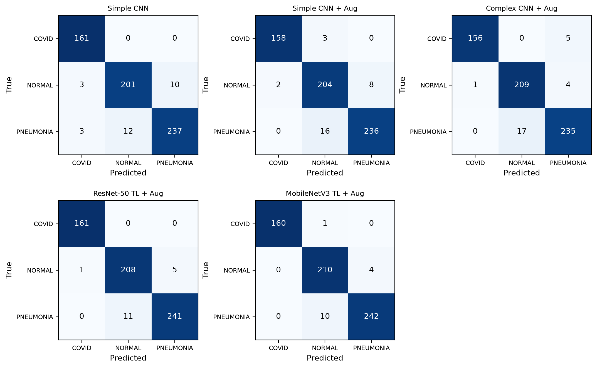
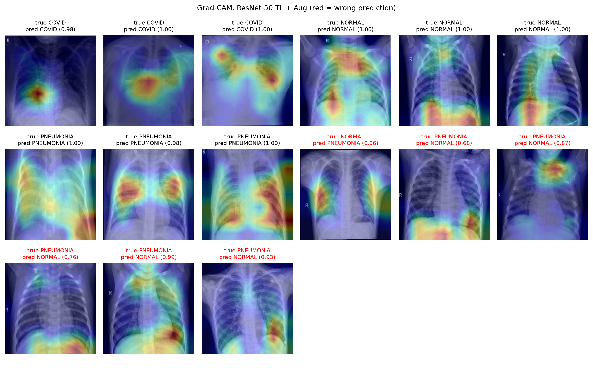

# Hướng dẫn cho cả nhóm: Dự án phân loại ảnh X-quang ngực

Tài liệu này giúp mọi người trong nhóm hiểu nhóm mình đang làm gì, đã làm đến đâu, mỗi file trong repo để làm gì và còn việc gì phải làm. Đọc từ trên xuống là đủ hiểu toàn bộ project, kể cả khi chưa mở code.

**Deadline nộp báo cáo + file dữ liệu + code: 11/10/2026.**

---

## Mục lục

1. [Tóm tắt nhanh](#1-tóm-tắt-nhanh)
2. [Đề bài và yêu cầu của cô](#2-đề-bài-và-yêu-cầu-của-cô)
3. [Dữ liệu: tải, làm sạch, chia tập](#3-dữ-liệu-tải-làm-sạch-chia-tập)
4. [Bốn mô hình](#4-bốn-mô-hình)
5. [Cách huấn luyện](#5-cách-huấn-luyện)
6. [Kết quả](#6-kết-quả)
7. [Phân tích: trả lời 3 câu hỏi của đề tài](#7-phân-tích-trả-lời-3-câu-hỏi-của-đề-tài)
8. [Hạn chế của project](#8-hạn-chế-của-project)
9. [Cấu trúc repo: file nào để làm gì](#9-cấu-trúc-repo-file-nào-để-làm-gì)
10. [Cách chạy lại trên máy mình](#10-cách-chạy-lại-trên-máy-mình)
11. [Việc còn lại: viết báo cáo](#11-việc-còn-lại-viết-báo-cáo)
12. [Giải thích thuật ngữ](#12-giải-thích-thuật-ngữ)

---

## 1. Tóm tắt nhanh

- **Bài toán:** cho 1 ảnh X-quang ngực, mô hình đoán ảnh thuộc 1 trong 3 lớp: **COVID-19**, **Normal** (bình thường), **Pneumonia** (viêm phổi).
- **Đã xong:** làm sạch dữ liệu, xây và train 5 mô hình, đánh giá trên tập test, vẽ toàn bộ hình, Grad-CAM.
- **Mô hình tốt nhất:** MobileNetV3 (transfer learning), đúng **97,6 %** ảnh test, F1 = **0,978**.
- **Báo cáo:** đã có bản nháp đầy đủ `doc/BaoCao_GiuaKy.md` (tiếng Anh, Markdown, theo mẫu của cô).

---

## 2. Đề bài và yêu cầu của cô

Cô yêu cầu 5 việc. Bảng dưới cho biết mình đã làm từng việc như thế nào và nằm ở file nào.

| # | Yêu cầu của cô | Nhóm đã làm | Code |
|---|---|---|---|
| 1 | Tiền xử lý: làm sạch, chuẩn hóa, tăng cường dữ liệu | Loại ảnh trùng, resize 224×224, chuẩn hóa pixel, augmentation (xoay, dịch, zoom, đổi sáng) | `src/nhom3/data.py` |
| 2 | CNN đơn giản tự thiết kế (conv, pooling, FC) | **Simple CNN**: 3 lớp conv + pool, 2 lớp FC | `src/nhom3/models.py` |
| 3 | CNN phức tạp tự thiết kế, dùng các khối (blocks) | **Complex CNN**: khối Inception (kiểu GoogLeNet) + khối Residual (kiểu ResNet) | `src/nhom3/models.py` |
| 4 | CNN dùng Transfer Learning / Fine-tuning | **ResNet-50** và **MobileNetV3** đã train sẵn trên ImageNet | `src/nhom3/models.py` |
| 5 | Đánh giá bằng độ đo phù hợp | Accuracy, Precision, Recall, F1, Confusion matrix, thêm Grad-CAM | `src/nhom3/train.py`, `src/nhom3/figures.py` |

Mẫu báo cáo của cô gồm: Part 1 lý thuyết CNN; Part 2 gồm I. Mô tả bài toán, II. Mô tả dataset, III. Thiết kế mô hình (1–4), IV. Kết quả thực nghiệm, V. Kết luận, References.

---

## 3. Dữ liệu: tải, làm sạch, chia tập

### 3.1 Dataset gốc

- Link: https://www.kaggle.com/datasets/sachinkumar413/covid-pneumonia-normal-chest-xray-images
- **5.228 ảnh PNG**: COVID 1.626, NORMAL 1.802, PNEUMONIA 1.800.
- Kích thước ảnh: 232×232 (4.228 ảnh) hoặc 256×256 (1.000 ảnh). Lưu dạng màu RGB nhưng thực chất là ảnh xám.
- Code tự tải bằng thư viện `kagglehub`, không cần tải tay. Ảnh được lưu ở `C:\Users\<tên>\.cache\kagglehub\...`, không nằm trong repo.



### 3.2 Làm sạch: vì sao và làm thế nào

Khi kiểm tra, nhóm phát hiện **rất nhiều ảnh bị trùng**. Đây là vấn đề lớn: nếu cùng một ảnh vừa nằm trong tập train vừa nằm trong tập test, mô hình chỉ cần "nhớ" ảnh đó là đoán đúng, nên điểm test sẽ cao hơn thực tế. Hiện tượng này gọi là **rò rỉ dữ liệu (data leakage)**.

Các bước làm sạch (theo thứ tự):

| Bước | Cách làm | Số ảnh bị loại |
|---|---|---|
| 1. Ảnh lỗi | Thử mở từng ảnh, ảnh nào không mở được thì bỏ | 0 |
| 2. Trùng hoàn toàn | Tính mã MD5 của file. Hai file cùng mã nghĩa là giống nhau từng byte, giữ 1 | 229 |
| 3. Gần trùng | Thu nhỏ ảnh thành "dấu vân tay" 16×16 (dHash). Hai ảnh có dấu vân tay khác nhau ≤ 4 bit thì coi là cùng một ảnh, giữ 1 | 819 |
| 4. Trùng nhưng khác nhãn | Một nhóm ảnh trùng mà có cả nhãn COVID lẫn NORMAL thì không biết nhãn nào đúng, bỏ cả nhóm | 3 |
| **Còn lại** | | **4.177** (COVID 1.077, NORMAL 1.425, PNEUMONIA 1.675) |

Ở bước 3, nhóm đã mở các cặp ảnh "gần trùng" ra xem bằng mắt: chúng đúng là cùng một ảnh, chỉ khác độ tương phản hoặc bị dịch nhẹ. Lớp COVID có nhiều bản sao nhất.



### 3.3 Chia tập train / validation / test

Chia theo tỉ lệ **70 / 15 / 15**, giữ đúng tỉ lệ giữa 3 lớp trong mỗi tập (stratified), dùng seed 42 để lần nào chạy cũng ra cùng một cách chia.

| Tập | Dùng để | COVID | NORMAL | PNEUMONIA | Tổng |
|---|---|---|---|---|---|
| Train | Cho mô hình học | 754 | 997 | 1.172 | 2.923 |
| Validation | Chọn tham số, quyết định khi nào dừng train | 162 | 214 | 251 | 627 |
| Test | Chấm điểm cuối cùng (chỉ dùng 1 lần) | 161 | 214 | 252 | 627 |

Danh sách ảnh nào thuộc tập nào được lưu ở `data/splits.csv`.

### 3.4 Chuẩn hóa và tăng cường dữ liệu (augmentation)

- **Chuẩn hóa:** chuyển ảnh xám, resize về 224×224, chia giá trị pixel cho 255 để về khoảng [0, 1], sau đó chuẩn hóa theo mean/std.
  - Hai CNN tự xây nhận ảnh 1 kênh.
  - ResNet-50 và MobileNetV3 được train sẵn trên ảnh màu, nên ảnh xám được nhân thành 3 kênh và chuẩn hóa theo mean/std của ImageNet.
- **Augmentation (chỉ áp dụng cho tập train):** mỗi lần đưa ảnh vào, ảnh bị biến đổi ngẫu nhiên một chút để mô hình học được nhiều kiểu ảnh hơn:
  - xoay ±10°,
  - dịch ngang/dọc tối đa 5 %,
  - phóng to/thu nhỏ 90–110 %,
  - đổi độ sáng và độ tương phản ±20 %.
- **Không lật ngang ảnh**, vì trên X-quang ngực tim nằm bên trái. Lật ngang sẽ tạo ra ảnh sai giải phẫu.
- **Mất cân bằng lớp:** COVID ít ảnh hơn 2 lớp kia, nên trong hàm loss mỗi lớp được gán trọng số tỉ lệ nghịch với số ảnh. Như vậy mô hình không "lười" bỏ qua lớp COVID.



---

## 4. Bốn mô hình

### 4.1 Simple CNN (yêu cầu 2)

Kiểu LeNet: chồng các lớp conv và pooling, cuối cùng là các lớp fully connected.

- Conv 5×5, 16 filter → ReLU → MaxPool 2×2 (ảnh 224 → 112)
- Conv 5×5, 32 filter → ReLU → MaxPool 2×2 (112 → 56)
- Conv 3×3, 64 filter → ReLU → MaxPool 2×2 (56 → 28)
- AdaptiveAvgPool về 7×7
- FC 128 → ReLU → Dropout 0,5 → FC 3 (3 lớp đầu ra)
- Khoảng **0,43 triệu** tham số.



### 4.2 Complex CNN (yêu cầu 3)

Kết hợp hai loại khối nổi tiếng:

- **Khối Inception** (giống GoogLeNet): đưa ảnh qua 4 nhánh song song (conv 1×1; conv 1×1 rồi 3×3; conv 1×1 rồi 5×5; maxpool rồi conv 1×1), sau đó ghép kết quả lại theo chiều kênh. Nhờ vậy mô hình nhìn được chi tiết ở nhiều kích thước cùng lúc.
- **Khối Residual** (giống ResNet): đầu ra = F(x) + x. Đường "tắt" cộng thẳng x vào giúp gradient truyền ngược dễ hơn, nên train được mạng sâu hơn.

Thứ tự các lớp: phần đầu (stem: conv 7×7, maxpool, conv 1×1, conv 3×3, maxpool) → 2 khối Inception → maxpool → 4 khối Residual → Global Average Pooling → FC 128 → FC 3. Có BatchNorm sau mỗi conv. Khoảng **7,6 triệu** tham số.



### 4.3 Transfer Learning (yêu cầu 4)

Dùng lại mô hình đã được train trên ImageNet (1,2 triệu ảnh, 1.000 lớp). Các lớp đầu của mô hình đã biết nhận cạnh, góc, kết cấu, nên mình chỉ cần dạy lại phần cuối.

- **ResNet-50**: 23,5 triệu tham số.
- **MobileNetV3-Large**: 4,2 triệu tham số, nhẹ hơn và nhanh hơn nhiều.

Train theo 2 giai đoạn:

1. **Feature extraction (5 epoch đầu):** đóng băng toàn bộ phần thân, chỉ train lớp FC mới (3 đầu ra), learning rate 1e-3.
2. **Fine-tuning:** mở khóa các tầng cuối (layer4 của ResNet-50, 4 khối cuối của MobileNetV3) rồi train tiếp với learning rate nhỏ hơn (1e-4) để không phá hỏng những gì mô hình đã học.




---

## 5. Cách huấn luyện

### 5.1 Cài đặt chung cho mọi mô hình

| Thành phần | Lựa chọn |
|---|---|
| Hàm loss | Cross-Entropy có trọng số theo lớp |
| Optimizer | AdamW, weight decay 1e-4 |
| Giảm learning rate | ReduceLROnPlateau: val loss không giảm sau 3 epoch thì nhân lr với 0,3 |
| Early stopping | Val loss không giảm sau 8 epoch thì dừng; giữ lại mô hình có val loss thấp nhất |
| Batch size | 32 |
| Số epoch tối đa | 40 (CNN tự xây), 30 (transfer learning) |
| Phần cứng | GPU laptop RTX 3050 6 GB, dùng mixed precision cho nhanh |

### 5.2 Dò hyperparameter cho Simple CNN

Thử 3 learning rate × 2 batch size = 6 tổ hợp. Chấm trên tập **validation**, không dùng tập test để chọn.

| Learning rate | Batch size | Val accuracy | Val F1 |
|---|---|---|---|
| **0,003** | **32** | **0,9569** | **0,9586** |
| 0,003 | 64 | 0,9537 | 0,9555 |
| 0,001 | 32 | 0,9537 | 0,9562 |
| 0,001 | 64 | 0,9442 | 0,9462 |
| 0,0003 | 32 | 0,9346 | 0,9375 |
| 0,0003 | 64 | 0,9250 | 0,9262 |

Kết luận: chọn **lr = 0,003, batch = 32**. Learning rate nhỏ thì học chậm, trong số epoch cho phép chưa kịp tốt bằng. Batch 32 tốt hơn batch 64 ở mọi learning rate.

### 5.3 Năm thí nghiệm chính

1. `simple_cnn`: Simple CNN, **không** augmentation
2. `simple_cnn_aug`: Simple CNN, **có** augmentation
3. `complex_cnn_aug`: Complex CNN, có augmentation
4. `resnet50_tl`: ResNet-50 transfer learning, có augmentation
5. `mobilenetv3_tl`: MobileNetV3 transfer learning, có augmentation

Thí nghiệm 1 và 2 để so sánh xem augmentation có giúp ích không.

---

## 6. Kết quả

### 6.1 Bảng chính (tập test, 627 ảnh, trung bình macro của 3 lớp)

| Model | Accuracy | Precision | Recall | F1-score | Số tham số | Thời gian train |
|---|---|---|---|---|---|---|
| Simple CNN | 0,9553 | 0,9557 | 0,9599 | 0,9577 | 0,43M | 62 s |
| Simple CNN + Aug | 0,9537 | 0,9565 | 0,9570 | 0,9566 | 0,43M | 264 s |
| Complex CNN + Aug | 0,9569 | 0,9605 | 0,9594 | 0,9596 | 7,56M | 370 s |
| ResNet-50 TL + Aug | 0,9729 | 0,9744 | 0,9761 | 0,9752 | 23,51M | 467 s |
| **MobileNetV3 TL + Aug** | **0,9761** | **0,9780** | **0,9785** | **0,9781** | 4,21M | 278 s |

Bảng chi tiết theo từng lớp nằm ở `results/results_tables.md`.

### 6.2 Đọc bảng thế nào

- **Transfer learning thắng rõ:** F1 cao hơn khoảng 2 điểm so với hai CNN tự xây. Nguyên nhân là dataset chỉ có khoảng 2.900 ảnh train, quá ít để mạng train từ đầu học tốt bằng mạng đã học sẵn từ 1,2 triệu ảnh.
- **MobileNetV3 tốt nhất dù nhỏ hơn ResNet-50 gần 6 lần**, và train nhanh hơn.
- **Complex CNN chỉ nhỉnh hơn Simple CNN một chút**, dù nhiều tham số hơn 17 lần. Mạng lớn cần nhiều dữ liệu hơn.
- **Augmentation không làm Simple CNN tốt hơn trên test** (0,9566 so với 0,9577, gần như bằng nhau). Tuy vậy, đồ thị cho thấy bản không augmentation overfit sớm: train loss tiếp tục giảm còn val loss đứng yên từ khoảng epoch 10, nên early stopping dừng ở epoch 18.

### 6.3 Đường cong huấn luyện

Đường xanh là train, đường cam là validation. Nét đứt ở hai mô hình transfer learning đánh dấu lúc chuyển từ giai đoạn đóng băng sang fine-tuning.



Điểm đáng chú ý: val loss của Complex CNN dao động mạnh, dấu hiệu mô hình lớn mà dữ liệu ít.

### 6.4 Confusion matrix

Hàng là nhãn thật, cột là nhãn mô hình đoán. Số trên đường chéo là đoán đúng.



---

## 7. Phân tích: trả lời 3 câu hỏi của đề tài

### Câu 1: Mô hình có hay nhầm COVID-19 với Pneumonia không?

**Gần như không.** Ở mọi mô hình, recall của lớp COVID đều ≥ 0,97. ResNet-50 đoán đúng cả 161/161 ảnh COVID. Chỉ Complex CNN nhầm 5 ảnh COVID thành Pneumonia.

### Câu 2: Lớp nào khó nhận diện nhất?

**Normal và Pneumonia hay bị nhầm với nhau nhất.** Lỗi phổ biến nhất là ảnh **Pneumonia bị đoán thành Normal**: 10 đến 17 ảnh trên 252, tùy mô hình. Trong y khoa đây là lỗi **âm tính giả** (người bệnh bị báo là khỏe), nguy hiểm hơn chiều ngược lại.

### Câu 3: CNN thực sự đang nhìn vào vùng nào trên ảnh? (Grad-CAM)

Grad-CAM tô màu vùng ảnh ảnh hưởng nhiều nhất đến quyết định của mô hình: đỏ là ảnh hưởng nhiều, xanh là ít. Tiêu đề màu đỏ là ảnh bị đoán sai.



Quan sát:

- Với ảnh đoán đúng, phần lớn heatmap nằm **trong phổi**: Pneumonia sáng ở hai bên phổi, COVID sáng ở vùng tổn thương.
- Nhưng có nhiều ảnh, nhất là ảnh đoán sai, heatmap lại nằm ở **bụng, cơ hoành, cổ hoặc góc ảnh**. Nghĩa là mô hình đôi khi dựa vào thứ không liên quan đến bệnh.

Grad-CAM của Complex CNN: `results/figures/gradcam_complex_cnn_aug.png`.

---

## 8. Hạn chế của project

Phần này **nên viết rõ trong báo cáo**. Cô sẽ đánh giá cao việc nhóm tự thấy được điểm yếu của mô hình.

1. **Mô hình có thể học "đường tắt" (shortcut learning).** Nhìn ảnh mẫu ở mục 3.1: ảnh NORMAL và PNEUMONIA là **ảnh trẻ em**, cùng một kiểu chụp và có chữ "R". Còn ảnh COVID là **ảnh người lớn** từ nguồn khác, có dây điện cực và chữ khác. Vì vậy COVID đúng gần 100 % có thể một phần là do mô hình phân biệt *nguồn ảnh / độ tuổi*, chứ không hẳn do nhận ra tổn thương COVID. Bài báo DeGrave et al. (2021) chỉ ra đúng vấn đề này.
2. **Không có mã bệnh nhân**, nên không loại được trường hợp hai ảnh khác nhau của cùng một người rơi vào hai tập khác nhau.
3. **Chỉ chạy 1 lần với 1 seed.** Tập test có 627 ảnh, nên chênh lệch 0,3 % (khoảng 2 ảnh) giữa ResNet-50 và MobileNetV3 không đủ để khẳng định mô hình nào chắc chắn tốt hơn.
4. **Không dùng được để chẩn đoán thật**, chỉ là bài tập học thuật.

Hướng phát triển: tách vùng phổi trước khi phân loại (để mô hình không nhìn ra ngoài phổi), chạy nhiều seed hoặc k-fold, kiểm tra trên dataset khác, làm web demo.

---

## 9. Cấu trúc repo: file nào để làm gì

```
nhom3/
├── src/nhom3/
│   ├── __init__.py      lệnh chạy: split / tune / train / figures
│   ├── data.py          làm sạch dữ liệu, chia tập, augmentation, nạp ảnh
│   ├── models.py        định nghĩa 4 mô hình
│   ├── train.py         vòng lặp train, early stopping, đánh giá, danh sách thí nghiệm
│   └── figures.py       vẽ mọi hình, tạo bảng, Grad-CAM
├── data/
│   ├── splits.csv               ảnh nào thuộc train / val / test (NỘP KÈM)
│   └── cleaning_summary.json    số ảnh bị loại ở từng bước
├── results/
│   ├── figures/                 toàn bộ hình cho báo cáo
│   ├── results_tables.md        3 bảng kết quả, chép thẳng vào báo cáo được
│   ├── train_log.txt            log khi train (bằng chứng đã chạy thật)
│   ├── simple_cnn/ ...          mỗi mô hình 1 thư mục (xem bên dưới)
│   └── tune_simple_lr*_bs*/     kết quả 6 lần dò hyperparameter
├── doc/
│   ├── HUONG_DAN_NHOM.md        file bạn đang đọc
│   └── report_notes.md          số liệu + ý phân tích xếp theo mẫu báo cáo của cô
├── pyproject.toml, uv.lock      danh sách thư viện
└── README.md                    hướng dẫn chạy ngắn
```

Trong mỗi thư mục `results/<tên mô hình>/`:

| File | Nội dung |
|---|---|
| `history.json` | loss và accuracy của train/val theo từng epoch (dùng để vẽ đường cong) |
| `meta.json` | cấu hình đã dùng, số tham số, số epoch, thời gian train |
| `metrics_test.json` | kết quả trên tập test: accuracy, precision, recall, F1, confusion matrix |
| `metrics_val.json` | như trên nhưng cho tập validation |
| `best.pt` | trọng số mô hình (**không** đưa lên git vì nặng; chạy lại sẽ có) |

`src/note.py` là notebook marimo cũ, chỉ có đoạn tải dữ liệu, không ảnh hưởng gì.

### Hình nào cho mục nào trong báo cáo

| Hình (`results/figures/`) | Mục trong báo cáo | Mức độ |
|---|---|---|
| `arch_simple_cnn.png` | III.2 | Bắt buộc |
| `arch_complex_cnn.png` | III.3 | Bắt buộc |
| `arch_resnet50_tl.png`, `arch_mobilenetv3_tl.png` | III.4 | Bắt buộc (ít nhất 1) |
| `confusion_matrices.png` | IV | Rất nên |
| `training_curves.png` | IV | Rất nên |
| `gradcam_resnet50_tl.png` | IV | Rất nên |
| `samples.png` | II | Nên |
| `class_distribution.png` | II hoặc III.1 | Nên |
| `augmentation.png` | III.1 | Nên |
| `gradcam_complex_cnn_aug.png` | IV | Tùy, nếu còn chỗ |

---

## 10. Cách chạy lại trên máy mình

Chỉ cần nếu muốn tự kiểm tra hoặc chạy thêm thí nghiệm. Kết quả đã có sẵn trong `results/`.

**Yêu cầu:** cài [uv](https://docs.astral.sh/uv/); nên có GPU NVIDIA (không có GPU vẫn chạy được nhưng chậm hơn nhiều).

```bash
uv sync                      # cài Python 3.13 và các thư viện
uv run nhom3 split           # tải dataset + làm sạch + chia tập (vài phút)
uv run nhom3 tune            # dò hyperparameter (~30 phút trên RTX 3050)
uv run nhom3 train           # train cả 5 mô hình (~25 phút)
uv run nhom3 train resnet50_tl   # hoặc chỉ train 1 mô hình
uv run nhom3 figures         # vẽ lại hình + bảng
```

Lưu ý:
- PyTorch đang dùng bản 2.11 cho CUDA 12.8, vì driver máy hiện tại chỉ hỗ trợ CUDA 12.9. Máy khác driver thì có thể cần sửa phần `[tool.uv.sources]` trong `pyproject.toml`.
- Lần đầu chạy, code tạo file `data/cache_*.pt` (ảnh đã resize sẵn, khoảng 200 MB) để các lần sau nạp nhanh. File này không đưa lên git.
- Kết quả có thể lệch rất nhẹ giữa các máy do GPU khác nhau.

---

## 11. Việc còn lại: viết báo cáo

### Bản nháp đã có

`doc/BaoCao_GiuaKy.md` là bản nháp hoàn chỉnh, tạo lại bằng `uv run python doc/make_report.py . doc/BaoCao_GiuaKy.md` (số liệu lấy tự động từ `results/`). Còn thiếu: số nhóm.

### Gợi ý chia việc (4 người)

Nhóm tự thống nhất ai làm phần nào. Dưới đây là cách chia gợi ý theo khối lượng tương đương:

| Phần | Nội dung | Tài liệu dùng |
|---|---|---|
| A | Part 1: Lý thuyết CNN (conv, pooling, FC, activation, loss, BatchNorm, Dropout, optimizer, LeNet/GoogLeNet/ResNet/MobileNet, transfer learning, Grad-CAM) | Mục 4 và 12 của file này, References |
| B | I. Mô tả bài toán + II. Dataset + III.1 Tiền xử lý | Mục 1, 2, 3; hình `samples`, `class_distribution`, `augmentation` |
| C | III.2 Simple CNN + III.3 Complex CNN + dò hyperparameter | Mục 4.1, 4.2, 5; hình kiến trúc |
| D | III.4 Transfer learning + IV. Kết quả + V. Kết luận | Mục 4.3, 6, 7, 8; confusion matrix, đường cong, Grad-CAM |

Cuối cùng một người ghép lại, thống nhất cách đánh số hình/bảng và gộp References.

### Checklist trước khi nộp

- [ ] Báo cáo đủ các mục theo mẫu của cô (Part 1, Part 2 I–V, References)
- [ ] Có hình minh họa kiến trúc cho cả 3 loại mô hình (yêu cầu 2, 3, 4)
- [ ] Bảng kết quả có đủ Accuracy, Precision, Recall, F1
- [ ] Có phần phân tích (3 câu hỏi ở mục 7) và hạn chế (mục 8)
- [ ] Nộp kèm code (`src/`), file dữ liệu (`data/splits.csv`, `data/cleaning_summary.json`) và `results/`
- [ ] Ghi link dataset Kaggle trong báo cáo
- [ ] Nộp trước **11/10/2026**

### Tài liệu tham khảo gợi ý

1. LeCun et al., "Gradient-based learning applied to document recognition", Proc. IEEE, 1998. (LeNet)
2. Szegedy et al., "Going deeper with convolutions", CVPR 2015. (GoogLeNet / Inception)
3. He et al., "Deep residual learning for image recognition", CVPR 2016. (ResNet)
4. Howard et al., "Searching for MobileNetV3", ICCV 2019.
5. Ioffe & Szegedy, "Batch normalization", ICML 2015.
6. Srivastava et al., "Dropout", JMLR 2014.
7. Loshchilov & Hutter, "Decoupled weight decay regularization", ICLR 2019. (AdamW)
8. Selvaraju et al., "Grad-CAM", ICCV 2017.
9. Zhang et al., *Dive into Deep Learning* (d2l.ai). Hình LeNet/GoogLeNet trong mẫu của cô lấy từ sách này.
10. DeGrave, Janizek & Lee, "AI for radiographic COVID-19 detection selects shortcuts over signal", Nature Machine Intelligence, 2021.
11. Dataset Kaggle (link ở mục 3.1).

---

## 12. Giải thích thuật ngữ

| Thuật ngữ | Nghĩa ngắn gọn |
|---|---|
| **Convolution (tích chập)** | Trượt một bộ lọc nhỏ (vd 3×3) trên ảnh để tìm đặc trưng như cạnh, vân. Cùng một bộ lọc dùng cho mọi vị trí. |
| **Pooling** | Thu nhỏ ảnh đặc trưng, vd MaxPool 2×2 lấy giá trị lớn nhất trong mỗi ô 2×2. |
| **Fully connected (FC)** | Lớp mà mỗi đầu ra nối với mọi đầu vào, dùng ở cuối mạng để ra quyết định. |
| **Softmax** | Biến 3 con số đầu ra thành 3 xác suất có tổng bằng 1. |
| **Epoch** | Một lần mô hình xem hết toàn bộ tập train. |
| **Batch size** | Số ảnh đưa vào mỗi lần cập nhật trọng số. |
| **Learning rate** | Độ lớn mỗi bước cập nhật trọng số. Quá lớn thì không ổn định, quá nhỏ thì học chậm. |
| **Overfitting** | Mô hình học thuộc tập train nhưng làm kém trên ảnh mới. Dấu hiệu: train loss giảm mà val loss không giảm. |
| **Early stopping** | Dừng train khi val loss không cải thiện nữa, giữ lại mô hình tốt nhất. |
| **Augmentation** | Biến đổi ngẫu nhiên ảnh train (xoay, dịch, đổi sáng...) để mô hình học tổng quát hơn. |
| **Data leakage** | Thông tin từ tập test lọt vào tập train (vd ảnh trùng), làm điểm test cao giả. |
| **BatchNorm** | Chuẩn hóa đầu ra mỗi lớp để train ổn định và nhanh hơn. |
| **Dropout** | Tắt ngẫu nhiên một phần nơ-ron khi train để giảm overfitting. |
| **Transfer learning** | Dùng lại mô hình đã train trên dataset lớn (ImageNet) cho bài toán mới. |
| **Fine-tuning** | Mở khóa một số tầng của mô hình đã train sẵn và train tiếp với learning rate nhỏ. |
| **Accuracy** | Tỉ lệ ảnh đoán đúng trên tổng số ảnh. |
| **Precision (lớp X)** | Trong các ảnh mô hình đoán là X, bao nhiêu % thực sự là X. |
| **Recall (lớp X)** | Trong các ảnh thực sự là X, mô hình tìm ra được bao nhiêu %. |
| **F1-score** | Trung bình điều hòa của precision và recall. |
| **Macro average** | Tính độ đo cho từng lớp rồi lấy trung bình cộng, mỗi lớp quan trọng như nhau. |
| **Confusion matrix** | Bảng đếm: nhãn thật (hàng) và nhãn đoán (cột). Cho biết lớp nào hay bị nhầm với lớp nào. |
| **Grad-CAM** | Kỹ thuật tô màu vùng ảnh ảnh hưởng nhiều nhất đến quyết định của CNN. |
| **Shortcut learning** | Mô hình đoán đúng nhờ chi tiết không liên quan (chữ trên ảnh, nguồn ảnh...) thay vì nhờ đặc điểm thật của bệnh. |
